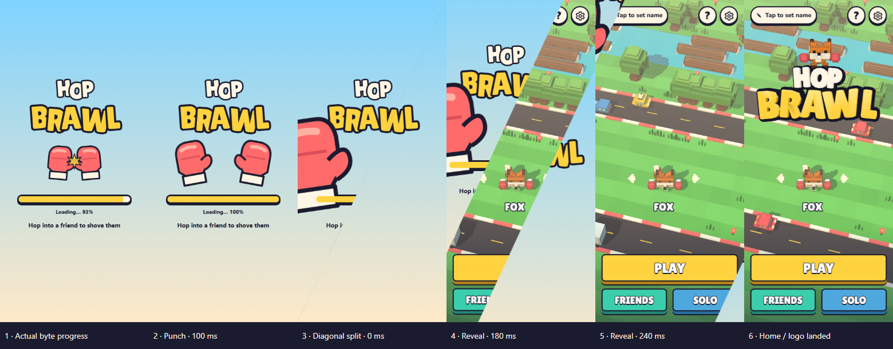
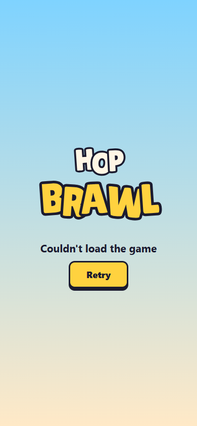

# Loading screen — §29.10

Completed 2026-10-15. The owner has signed off the final models and authorized M3 after this loading screen.

- Production index.html is **12,225 bytes**, including inline CSS and the Lilita One SVG paths (limit 15,000). No external font, image or blocking stylesheet is needed for first paint. The old loading-box/blur stage is removed.
- Coral gloves tap every **600 ms**, with contact spark. Required model/font progress uses actual streamed bytes against build-generated decoded file lengths: **614,572 bytes**. No required sound download exists yet; current SFX are synthesized. Tips rotate every **2.5 s**.
- All models decode and every quality tier warms before Home starts rendering underneath. A **180 ms punch**, then **300 ms diagonal reveal**, exposes the live Home; its 3D logo starts dropping afterward. The six frames sample the real production Web Animations poses with animations paused for capture.
- Under **400 ms**, gloves/bar remain hidden and only the split runs. After **8 s**, the slow-connection message appears. Retry requests only failed files and preserves successful buffers and the canvas. Reduce Motion uses only a **200 ms fade**.
- Five fresh browser contexts with HTTP cache cleared/disabled: **2.532, 1.597, 1.706, 1.496, 1.485 s** to interactive Home. Maximum **2.532 s**, median **1.597 s**. First contentful paint: **140, 48, 48, 48, 48 ms**. Includes the complete transition. These are local production desktop measurements on Intel Iris Xe, not a deployed 4G or physical-phone certification.
- An initial measured cold run exceeded 3 s. Downloads now overlap renderer creation, and the output shader begins compiling while assets arrive. The numbers above are the final optimized build, measured without concurrent browser tests.
- **90 unit tests** plus strict typecheck/build pass. All **20 desktop/touch browser cases** verified: the full run passed 19; the independent determinism case hit its former 30 s test timeout. It and its mobile counterpart then passed with a 90 s computation-test timeout. All eight loading cases passed again after the startup optimization. Production load timing is separately measured above.

Raw measurements: [loading-measurements.json](loading-measurements.json). Reproduce with `npm run build:client`, serve the production build on port 4173, then `node scripts/review-loading.mjs`.

Review http://localhost:5173/ in normal/incognito windows; use browser network throttling for tips/slow state and block a model request to exercise Retry. No additional approval gate was requested: proceed to M3 and stop after Solo is playable.
