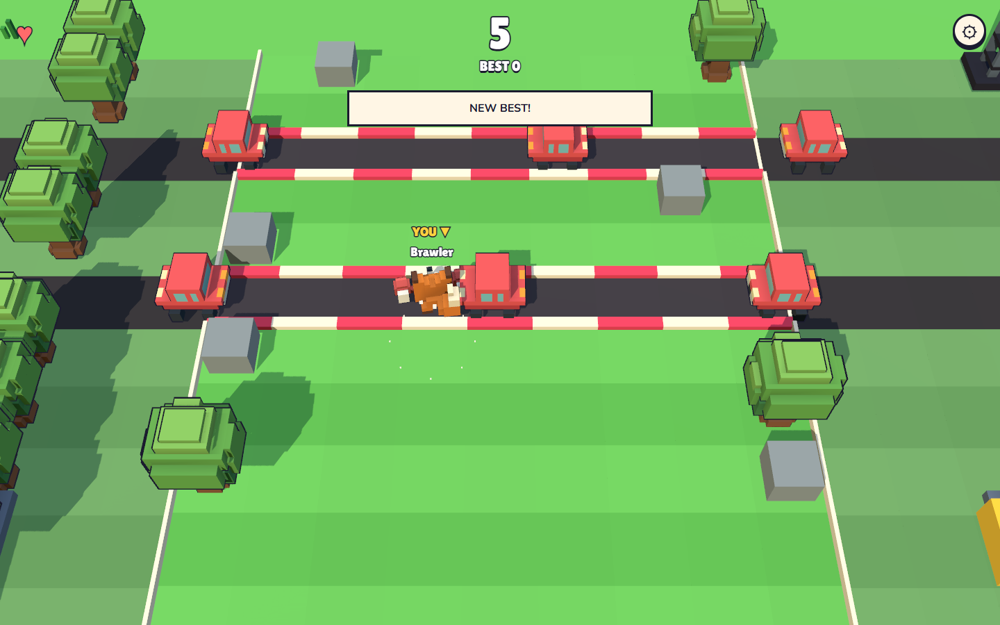
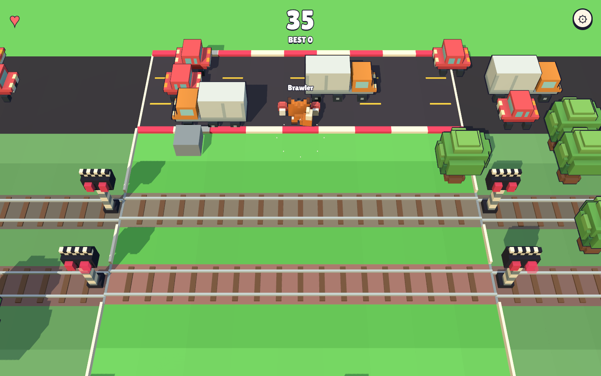
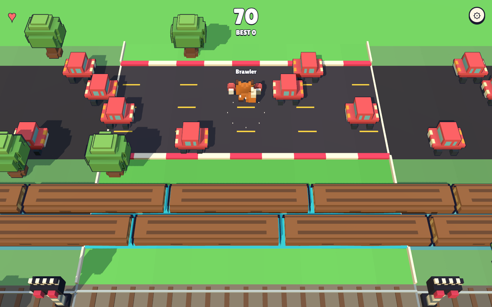
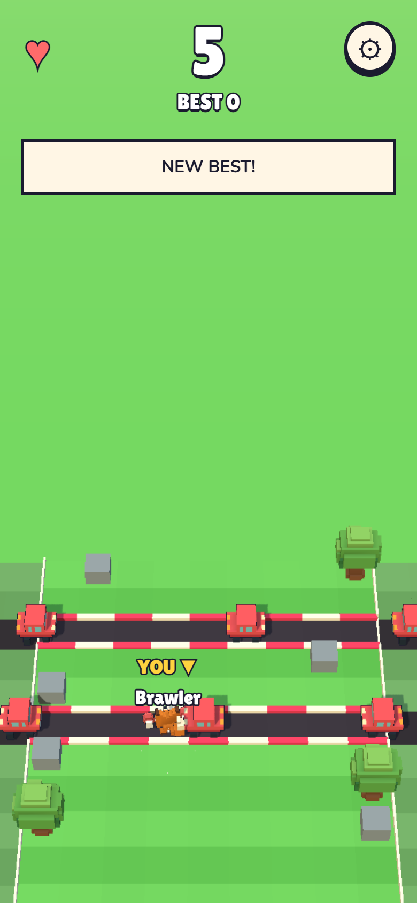
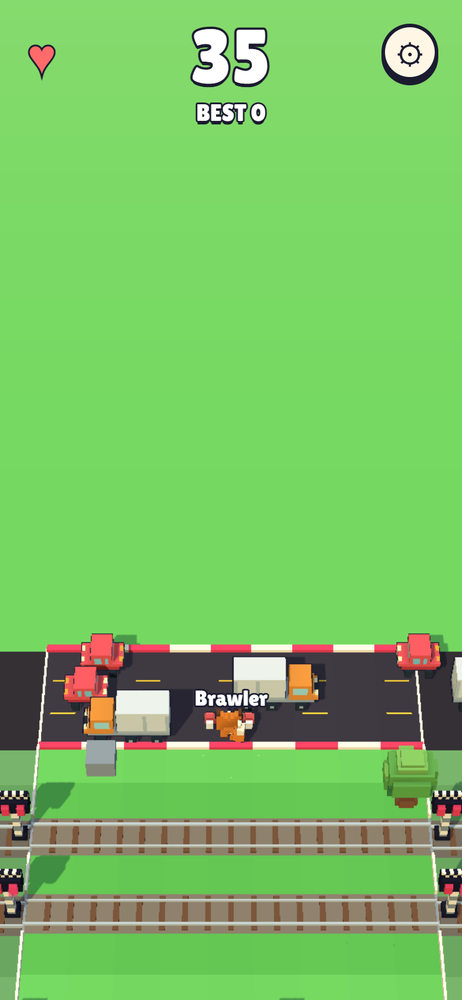
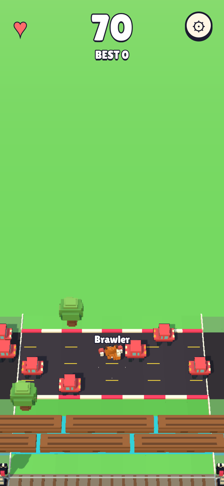

# M3 section 30 review

2026-10-15. M3 remains subject to owner playtest approval. No M4 work or deployment.

## Changed behavior

- Grass scenery checks entire footprints; arena props stay at least two columns outside. Hazard rows retain their matching terrain outside the playfield.
- The gameplay camera follows logical camZ exactly. Its projected bottom is the death boundary; a danger vignette precedes Left Behind. Hidden-tab return and frame gaps over 250 ms pause Solo and settle UI/logo poses. The exited name sheet is hidden at zero opacity.
- Eleven visible rows, distinct lowered/darkened/desaturated outside tiles, continuous boundaries, edge bonk pulses and log-edge warnings.
- Deterministic tiered segments, grass between all hazards, rest stops, shared grass corridors, road speed contrast, alternating river directions and train warnings.
- The scroll grace period starts with the first accepted hop. Log hops target the nearest slot at actual landing time, curve toward that slot, then carry at its exact position.
- Gravel tracks, half-tile wooden sleepers, steel rails, two Blender warning posts, flashing lamps, a pulsing warning bed and bell. Blender engine/carriages have headlights; nearby trains cause bounded shake disabled by Reduce Motion.

## Framing measurements

Measured by projecting the playable edges at the middle visible row through the actual gameplay camera. Character height projects every visible vertex of the live fox at its starting row.

| Viewport | Nine playable columns | Including half-tile side margins | Fox height |
|---|---:|---:|---:|
| 1440×900 | 56.35% (minimum 45%) | 62.61% | 97.89 px (minimum 48 px) |
| 390×844 | 84.60% | 94.00% (minimum 92%) | 32.96 px |

## Generator audit

`tests/unit/worldgen-fuzz.test.ts`: **1,000 seeds × 300 rows**, **154,396 segments**, **25,732 adjacent river pairs**, zero violations. Rest-stop crate frequency **50.157%**; ordinary grass **24.694%**. [Raw counts](playtest30-fuzz.json).

Assertions cover deterministic/random-access output, every tier's segment lengths/speeds/obstacle limits, grass separators, 20-row rest intervals and clear columns 2–6, shared two-column corridors, single-obstacle hazard edges, opening single lanes, no early trucks/rails, road direction/speed contrast/gaps, log length/non-overlap/speed, warning durations and train periods. Separate 1,000-seed scenery and segment-planner tests cover complete grass-only footprints and arena setbacks. Movement tests cover first-hop timing and slot landing/carry/lateral exits.

The owner's river interpretation is maximum wait for a **landable slot**, not log-center intervals. Uniform log spacing and speed make each row periodic. The audit computes the exact uncovered interval at every column. For opposite-moving adjacent rows, it checks a phase-independent bound on the union of their unavailable intervals, including erosion by the required 0.5-second overlap. This proves the overlap frequency for continuous time, rather than sampling a few favorable timestamps.

## Validation and captured runs

- **113 unit tests across 25 files pass**, including strict TypeScript and the production build.
- All **30 browser cases** are covered by passing results: the full suite passed 28 and found two outdated architecture assertions about intermediate camera windows; after correcting those assertions, all four desktop/mobile architecture cases passed. The final grass-canopy footprint fix also passed that rerun. Actual rendered Left Behind frames, >250 ms hitch pauses, exact logo poses and zero-opacity hidden name sheets pass on both viewports.
- Both seeded input-driven review runs reached rows **5, 35 and 70 alive**, with **zero page errors**. [Raw run records](playtest30-run.json). The test-only lookahead is not shipped gameplay; these runs do not establish human difficulty or physical-phone performance.
- At row 70: desktop High **59 draw calls / 38,996 triangles**; touch viewport Medium **50 calls / 32,006 triangles**. Both rolling p95 snapshots were **16.7 ms** on the host GPU. Real-device playtesting remains required.
- Five production cold-cache Home loads: **1699.3, 1644.3, 1660.1, 1712.1, 1685.1 ms**. Median **1685.1 ms**, maximum **1712.1 ms**, all under 3 seconds. [Raw loading measurements](playtest30-loading.json).
- New Blender warning post: **16,424 bytes**, baked vertex colors, no textures, closed voxel geometry. Asset/source/license recorded in CREDITS.md.

### Desktop 1440×900

Row 5:

Row 35:

Row 70:

### Phone viewport 390×844

Row 5:

Row 35:

Row 70:

## Owner playtest

Open http://localhost:5173/ in normal and incognito windows. Select Solo in each. They are independent local runs until the networking milestones.

1. Wait before your first hop: scrolling must remain stopped. Make a few hops; verify the bottom warning/death agrees with what is visible.
2. Cross roads and rivers; inspect terrain outside both boundaries. Follow grass corridors and rest stops around rows 20, 40 and 60.
3. Ride a log, hop left/right between slots and onto the bank. Near a side edge, check the red pulse and `!` warning.
4. From row 30, check the tracks, two flashing posts, bell and approaching engine/carriages. Enable Reduce Motion and confirm train shake stops.
5. Switch tabs, return, resume and retry. Change your name and check that the old panel leaves no faint rectangle. Reload Home under CPU throttling and check the final logo pose.
6. On a phone on the same Wi-Fi, open http://192.168.7.7:5173/. Check tap/swipe response, boundary clarity, logs and pause/rotation. Physical-phone feel remains owner-assisted.

Run locally with `npm run dev -- --host 0.0.0.0`. Solo needs no Worker yet. Reproduce unit/build checks with `npm run check`, browser regressions with `npm run test:e2e`, and review captures with `node scripts/review-playtest30.mjs` (dev 5173 and production preview 4173). Browser runs must be serial. The review driver uses actual shared movement inputs with lookahead; it does not teleport, disable collisions or modify hazards. It freezes simulation only while saving a screenshot.
