# Final model sign-off — SPEC §29.7–§29.9

Captured 2026-10-15 from the production build. **Street Brawl direction is approved; final model sign-off is pending. M3 has not started.**

The checklist below links every requested image. Native grass captures use the actual Home camera and distance, not an enlarged model viewer. Blender previews use the final exported anatomy and gear.

| §29.9 | Verification | Evidence |
|---|---|---|
| 1 | All six animals in both required views | 3/4 and grass lineups below |
| 2 | Guard faces inspected in both views; silhouette recognition supplied for owner sign-off | Both lineups and black silhouettes |
| 3 | No headbands; floating chamfered fists, inner thumbs, white cuffs, top-front highlights and knuckle ridges | Both lineups; four-color fox |
| 4 | One fox geometry, all four player colors; cuffs remain white | Coral / blue / green / purple sheet |
| 5 | Six sampled runtime frames for each requested move | Tap, 1–2 combo, victory strips |
| 6 | Same unlit baked vertex colors; visible Ink backing; no logo fog; fox 2.5× larger | Blender / production Home comparison |
| 7 | Both requested Home viewport sizes | 1440×900 and 390×844 images |
| 8 | All 18 runtime GLBs closed; 643,416 bytes; worst cold desktop TTI 1.470 s | Measurement image and raw audits |

## 1–3. Animals, faces, silhouettes and gloves

Each fist is independently recolorable; its separate white cuff shares the wrist handle. Main fist widths are approximately 42–50% of the corresponding head width, with a small inner thumb bump. The approved anatomy is preserved at a finer voxel resolution. Gameplay hitboxes are unchanged.

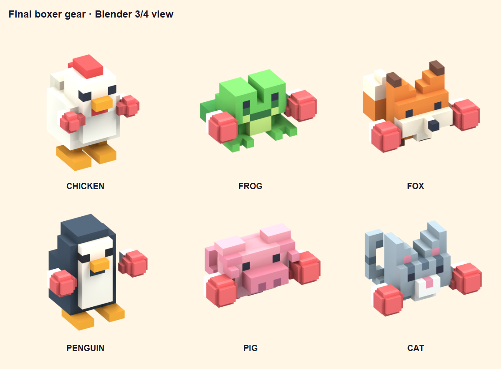

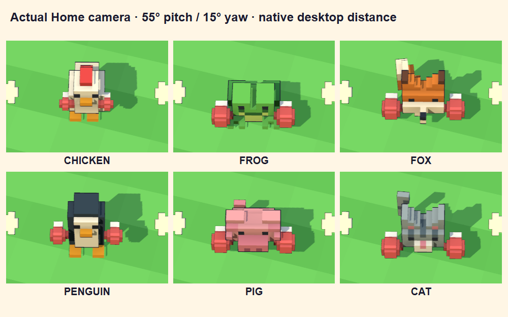

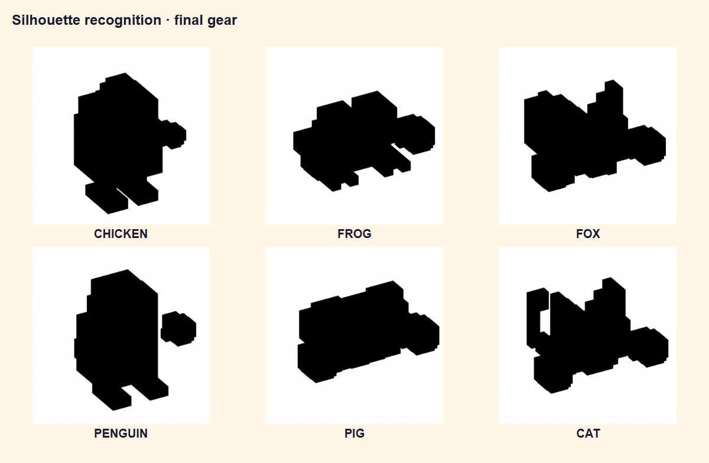

## 4. Four fox colors

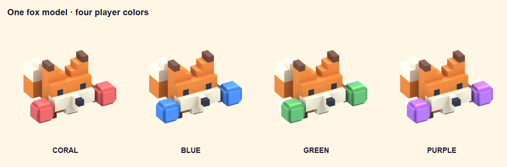

## 5. Moves and event behavior

The reusable controller implements all specified presentations. Home tap/click throws the combo; arrow/swipe selection lands into a glove tap. Automatic idle flourishes choose tap, combo or shoulder shake at random 3–5 second intervals. Body bounce is 2 Hz. Reduce Motion disables automatic flourishes and halves bounce amplitude; explicit action poses remain available.

| Event | Implemented presentation / verification |
|---|---|
| Idle | Guard sway, boxer bounce, random tap / combo / shoulder shake |
| Hop | Backward take-off swing and forward landing follow-through |
| Shove | Side-selected glove extends 0.4 tile; body lean; contact star and hit sound |
| Shoved/stunned | Raised gloves, body wobble and three dizzy stars |
| Countdown | Guard adapter; HOP adapter triggers the double glove tap |
| Round/match win | Both gloves overhead, victory bounce and crowd cheer |
| Home click/tap | 350 ms left jab / right cross and synthesized whoosh |
| Animal select | Tap after the new animal lands |
| Lobby join | Join adapter triggers that animal's tap |

Countdown, lobby join and match outcome adapters are implemented and unit-tested. Their actual network/gameplay event sources arrive in the existing later milestones. This pass does not add gameplay before the M3 sign-off gate. Contact sounds are original synthesized one-shots, enabled by a user gesture and controlled by SFX volume.

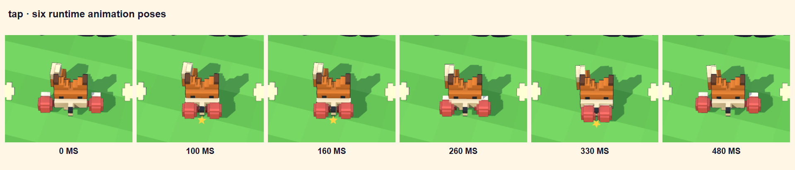

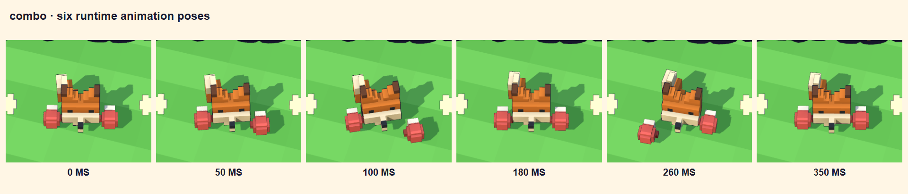

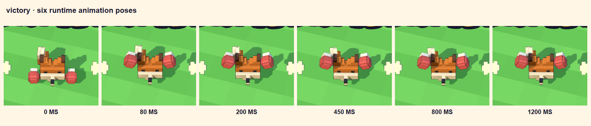

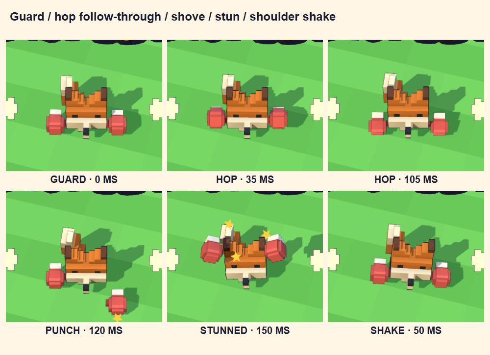

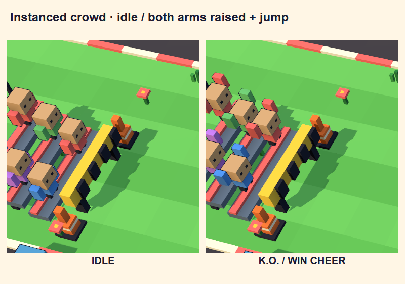

## 6. Logo matching

Logo GLB: **155,500 bytes**, below 200,000. The fox is exactly **2.5×** its former mascot scale. Both preview and runtime use the same baked vertex colors without world lighting; runtime materials also exclude fog and tone mapping. The Ink backing stays visible on all tiers under §29.8.

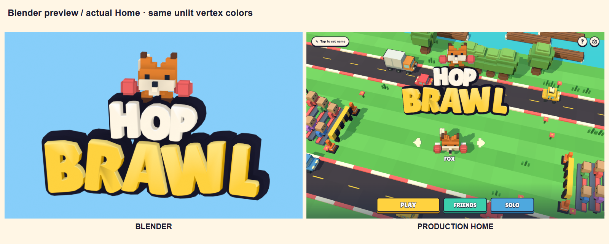

## 7. Home and arena

The animal name is Lilita One UI text in white with Ink outline; the old sign/text geometry is removed. The 3D arrows are opaque and outlined on all tiers. The selection stage has clearance for overhead victory poses and dizzy stars.

Bleacher bounding boxes start **2.15 tiles outside the playable edge**. Structures within two columns reach at most **0.917 tile**, below the **1.5-tile** cap. Bunting is **1.5 tiles** tall. Towers are **16 rows apart**, at Home Z positions 10 and 26, away from the top visible rows. Crowd height is **1.5×** the former version. Instances share a GPU animation clock; cheering raises both arms and jumps without per-spectator CPU updates.

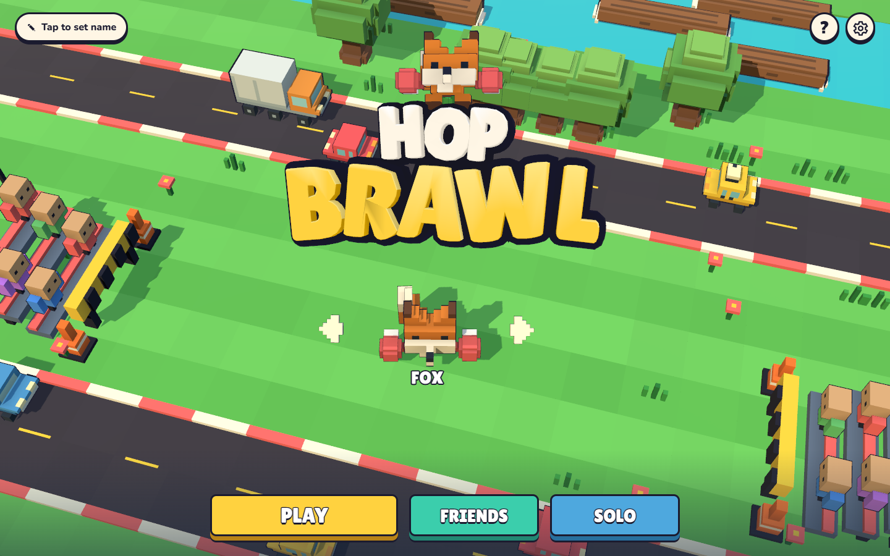

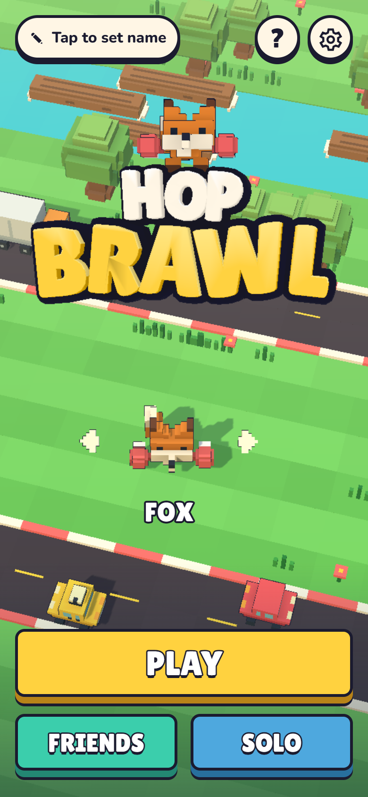

## 8. Geometry, size, loading and tests

- **18 runtime models: 643,416 bytes**, against a 2,000,000-byte cap. All runtime plus archived variant GLBs total **1,144,068 bytes**.
- **0 open boundary segments; 0 flat meshes.** The audit welds coincident points, splits collinear/T-junction edges, checks directed edge cancellation and rejects zero-volume meshes. Two previously uncapped logo backing contours were repaired in Blender.
- Five production desktop loads, each with a new browser context and HTTP cache cleared/disabled: **1.470, 0.688, 0.935, 1.080, 1.052 seconds**. Median **1.052 s**; maximum **1.470 s**, below **3 s**.
- All **15 Home model requests** finish before Home becomes interactive; Loading awaits model loading and shader/geometry warm-up. The first contact spark is also warmed, including portrait views.
- Production Home: **82 draws on High, 75 on Medium**; Medium remains below 80. No console/page errors in the evidence capture. These are local Intel Iris Xe measurements, not a deployed-network or physical-phone benchmark.
- Full desktop/touch browser suite: **12 passed**. Build, strict typecheck and unit checks are recorded in PROGRESS.md. Browser checks cover persistent canvas/resources, carousel directions, touch swipes, settings/navigation, scene stability, crowd cheer lifetime and DPR 1/1.25/1.5/2 coverage.

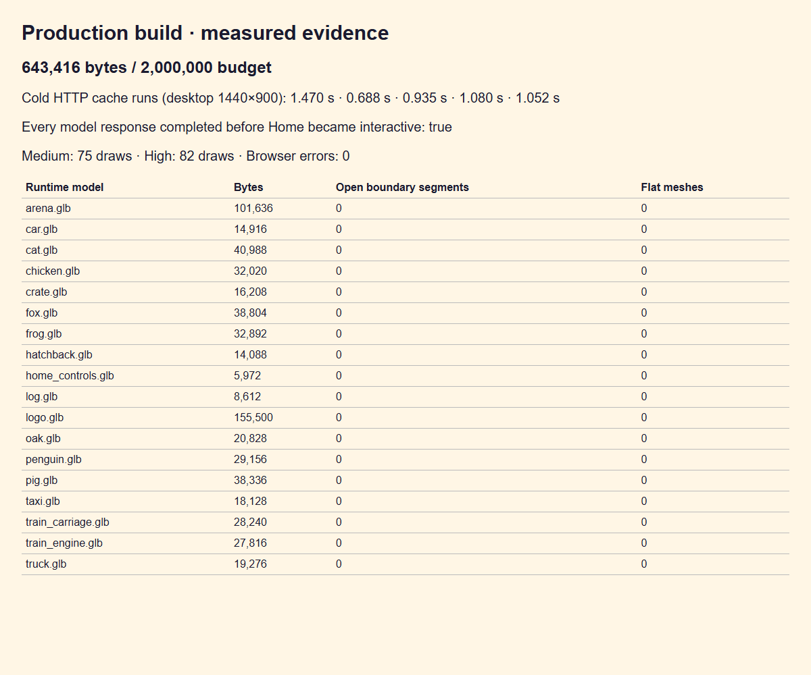

Raw evidence: [geometry-audit.json](geometry-audit.json), [browser-measurements.json](browser-measurements.json).

## Owner review

Open http://localhost:5173/ in normal and incognito windows. Check all six guard faces, tap the animal for the combo, switch animals for the landing tap, and toggle Reduce Motion/SFX volume. At http://localhost:5173/?debug=1 choose a move and press Play to inspect hop, punch, stunned, guard, victory and flourishes; Crowd K.O. tests the shared cheer. Production preview is http://localhost:4173/.

On the same Wi-Fi, use http://192.168.7.7:5173/ for phone swipes, rotation and actual-device smoothness. **Wait for the owner's final sign-off before tagging M2.5 complete or starting M3.**
