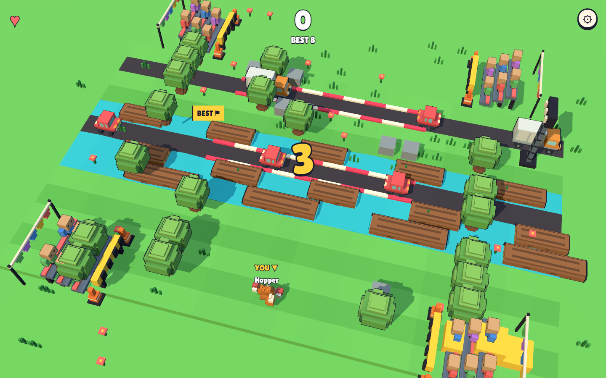
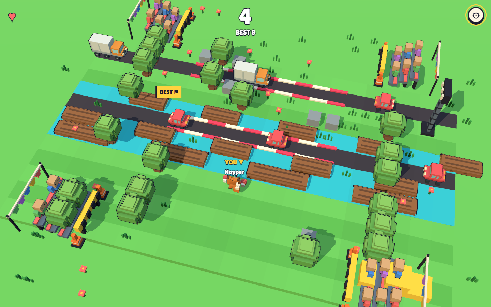
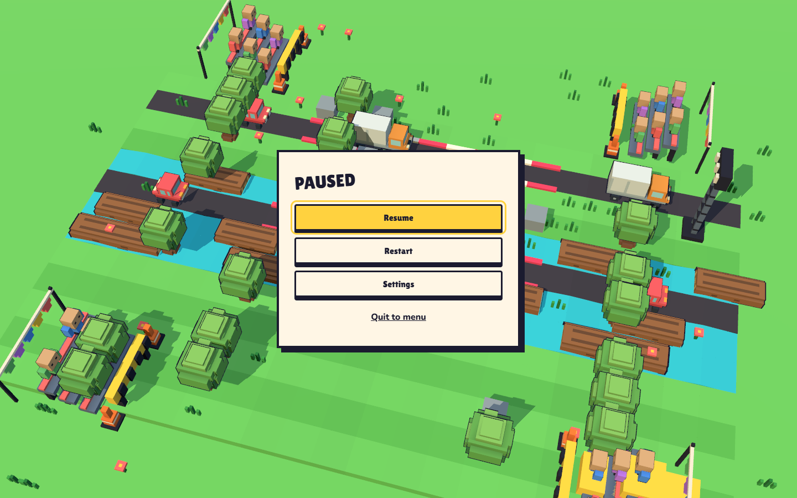
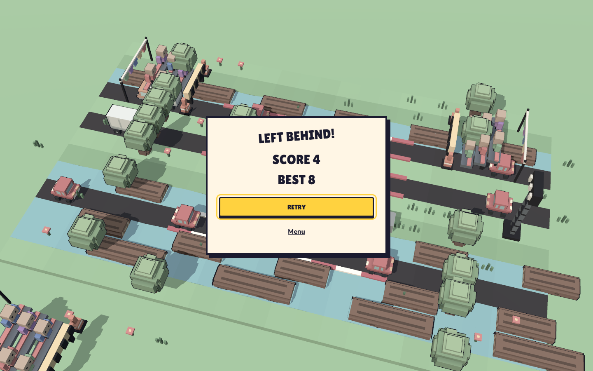
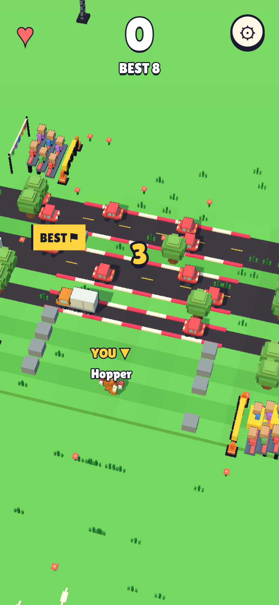
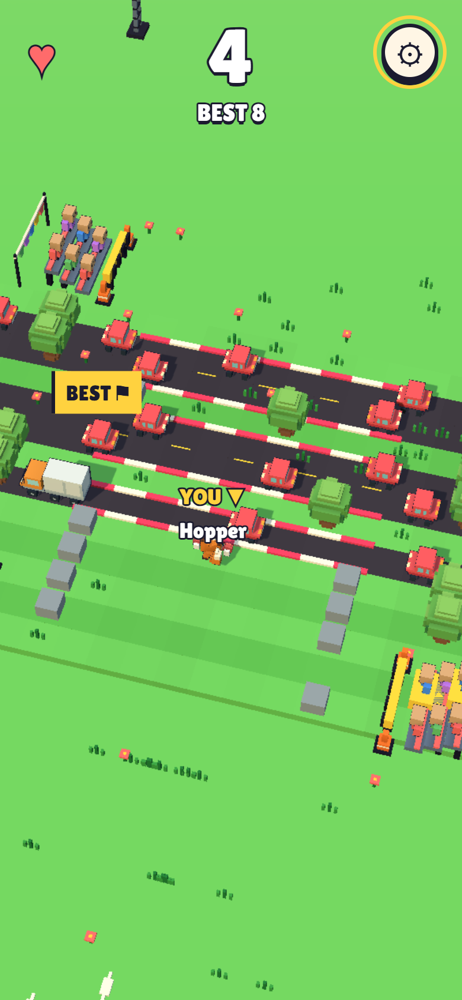
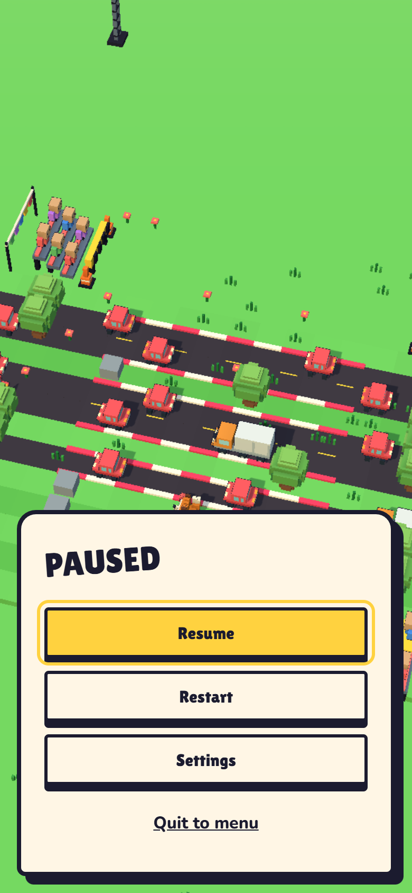
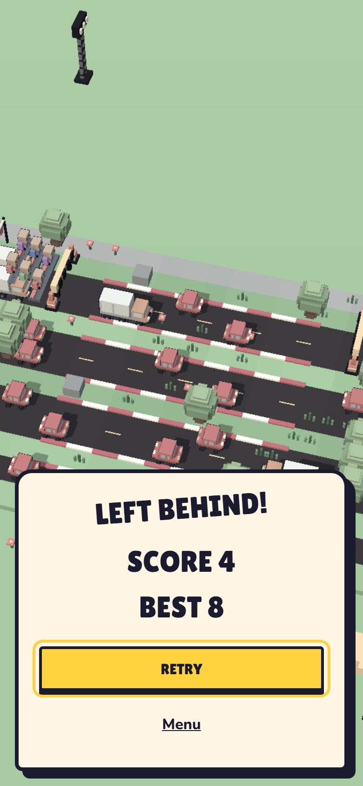

# M3 Solo review

2026-10-15. Implementation complete; waiting for owner playtesting before M4. All work remains local.

## Play locally

Open http://localhost:5173/ in a normal and an incognito window. On the same Wi-Fi, open http://192.168.7.7:5173/ on a phone. If the server has stopped, run `npm run dev -- --host 0.0.0.0` from the project root. No server connection is needed for Solo.

1. Choose SOLO, enter a name if prompted, and wait for 3–2–1–HOP. Input during countdown should do nothing.
2. PC: arrows/WASD or click to hop forward. Phone: tap forward; swipe in any direction. A swipe should begin moving as soon as it crosses the threshold, before finger-up. Rapid presses should buffer only one extra hop; held keys should not repeat.
3. Try obstacle/edge bonks, traffic, water/logs and trains. Ride a log, hop off it, and let the scrolling bottom catch you. Solo has one heart and no respawn.
4. Use Esc/gear to pause, open Settings and return, then Resume through the countdown. Switching tabs or apps should pause. Try Low and Reduce Motion.
5. After death, use Retry and Space/Enter. The world should reset beneath a tile flip without a blank frame or new loading screen. Beat your best and reload; normal and incognito storage should remain separate.
6. On a phone, rotate during a paused run and resume; check responsive gestures, readable HUD, stable frame pacing and no white edges. Report the device/browser and what happened if anything feels wrong.

Multiplayer starts in M4–M6. Crates/boosts remain M9 (inactive pickups are hidden), remaining biome art M10, full audio M11, and the owner's punch-toward-camera / fox-tail notes M12. Those model polish changes were not made early.

## Verification and measurements

- `npm run check`: **100 unit tests in 22 files**, strict TypeScript and production build pass. Includes 300,000 generated-row fuzz cases, buffered movement, all five death causes, log exit/carry boundaries, immediate swipe input and denied/corrupt best storage.
- Full Playwright suite: **24/24 desktop/mobile cases passed**. After the final viewport and countdown refinements, all **8 targeted Solo/architecture cases passed again**. These cover pause/Settings/resume, focus-loss pause, death/retry, actual canvas identity, graphics changes, bounded resources and touch/keyboard input.
- Review script plays actual Solo input, pauses/resumes, waits for a natural Left Behind death and retries. Both review contexts reported **zero page errors**. Screens below are settled UI states, not mid-transition captures.

| Review snapshot | Desktop 1440×900 | Touch viewport 390×844 |
|---|---:|---:|
| Tier | High | Medium |
| Renderer DPR | 1 | 1.5 |
| Rolling p95 frame time | 16.8 ms | 16.7 ms |
| Rolling worst frame | 16.8 ms | 16.8 ms |
| Draw calls | 58 | 47 |
| Triangles | 47,568 | 36,242 |
| Recycled row slots | 25 | 25 |
| Retry click → world reset | 318.5 ms | 301.3 ms |
| Retry click → HOP observed | 1022.7 ms | 1007.5 ms |

The configured Retry countdown is 1000 ms and overlaps the tile flip; observations include the next animation frame and browser polling. The world reset itself is below one second. Frame snapshots use the host Intel Iris Xe GPU with Chromium D3D11 and a rolling two-second window. They do not certify sustained physical-phone performance or the later required 60-second, 4× CPU, two-player/GC trace test. The desktop p95 is 0.1 ms above the nominal 16.7 ms budget due to observed frame cadence; physical-device and sustained validation remain outstanding.

Final production cold-cache Home load, five independent contexts with cache cleared/disabled: **1666.6, 1596.6, 1591.5, 1543.4, 1660.2 ms**. Median **1596.6 ms**, maximum **1666.6 ms**, all below 3 seconds including the reveal. First contentful paint: **64, 52, 44, 44, 48 ms**. Inline HTML remains **12,225 bytes** (<15,000). The real-byte registry now includes all 18 required GLBs plus fonts: **686,836 bytes**; required sounds are currently synthesized. Main production JS is approximately **228 KB gzip** (<400 KB).

Raw evidence: [run/frame measurements](solo-measurements.json), [cold production loads](solo-loading-measurements.json). Reproduce after `npm run build:client`, with dev on 5173 and production preview on 4173, using `node scripts/review-solo.mjs`. Run browser suites/captures serially to avoid competing GPU work. Random seeds differ between runs and screenshots.

## Desktop screens

## Phone screens

The viewport is 390×844; PNGs are captured at device scale 2.

